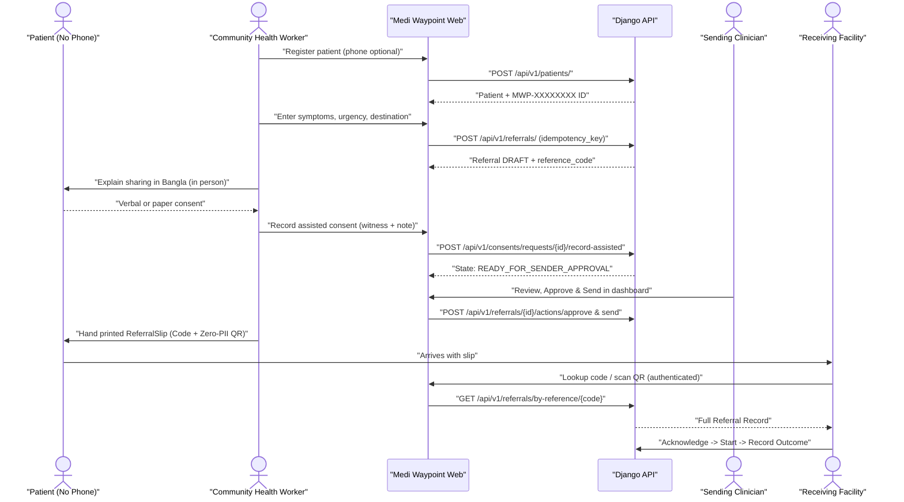
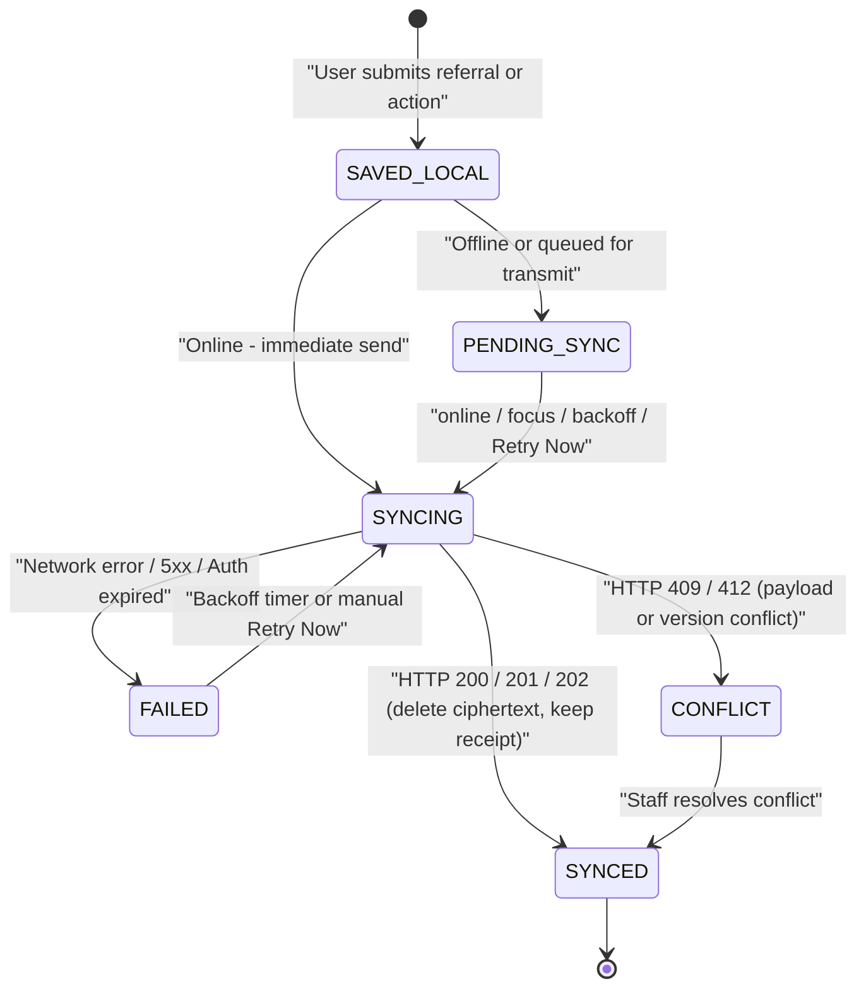
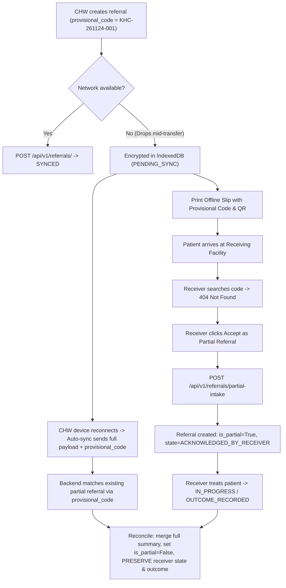

# Medi Waypoint — UX and Workflow Design (Phase 2)

**Date:** 2026-11-24  
**Branch:** `development` (`ae7b5e9`)  
**Status:** Phase 2 Design Specification — Awaiting Approval Before Implementation  
**Depends On:** [MEDI_WAYPOINT_INTEGRATION_AUDIT.md](MEDI_WAYPOINT_INTEGRATION_AUDIT.md), [MASTERPLAN.md](MASTERPLAN.md)

---

## 1. Executive Summary

This document specifies the end-to-end UX, workflow, state-machine, API, data-model, offline-queue, reconciliation, and security design for integrating Medi Waypoint's two mandatory field challenges into the existing codebase:

1. **Challenge 1 — Referral for a Patient Without a Personal Phone:** Enables Community Health Workers (CHWs / `facility_staff` with `referral.create`) and clinicians to register phone-less, email-less, account-less patients with an auto-generated human-readable ID (`MWP-XXXXXXXX`), capture symptoms/triage, record audited in-person assisted consent (`assisted_verbal` / `assisted_paper`), create and track referrals, print a slip with a zero-PII QR retrieval token, and allow the receiving facility to retrieve and accept the patient without relying on SMS or patient device ownership.
2. **Challenge 2 — Referral Continuity During Network Failure & Partial Referral Acceptance:** Extends the existing AES-GCM encrypted IndexedDB offline queue (`frontend/src/offline/`) to support standard/CHW referral creation and offline status updates across refreshes/restarts, adds server-side idempotency to standard referrals, exposes all 5 explicit sync states, introduces a **Receiving-Facility Partial Intake** workflow when a patient arrives before the full referral syncs, and defines a deterministic, non-regressing **Reconciliation Engine** that merges delayed full records without losing receiver progress or fabricating missing clinical data.

Every design choice reuses the existing Django modular monolith, declarative workflow engine (`apps/workflow/engine.py`), "Handover" design system tokens (`frontend/src/tokens/`), and `idb` + Web Crypto encryption layer.

---

## 2. Existing Functionality Reused vs. Changed vs. New

| Capability | Classification | Existing Asset / Location | What Changes or Is Added |
|---|---|---|---|
| **Patient model & nullable phone** | **Existing (Reused)** | `backend/apps/identity/models.py` (`Patient.phone` nullable, `PatientIdentifier`) | Add `system_id` choice to `PatientIdentifier`; auto-generate `MWP-XXXXXXXX` in `create_patient_record`. |
| **Patient search API** | **Existing (Reused)** | `GET /api/v1/patients/?q=...` (`apps/identity/selectors.py`) | Automatically matches new `MWP-XXXXXXXX` identifier because `search_patients` already queries `identifiers__value`. |
| **Patient registration UI** | **New** | None (`/patients` only searches today) | Add reusable `RegisterPatientForm` (phone/email optional) on `/patients` and inline in `/referrals/new`. |
| **Consent model (`method` + `verification_context`)** | **Existing (Reused)** | `backend/apps/consent/models.py` (`Consent.method`, `verification_context`) | **No schema change needed.** Add `record_assisted_consent` service & endpoint for patients without `PatientAccount`. |
| **CHW permission code** | **Existing (Reused)** | `backend/apps/accounts/catalogue.py` (`referral.create` already defined!) | Wire `referral.create` into `create_referral_draft`, `update_referral_draft`, `request_consent`, `ReferralsIndex` (`outgoing` tab), and add `consent.record_assisted`. |
| **Reference & provisional code lookup** | **Existing (Reused)** | `GET /api/v1/referrals/by-reference/<code>` & `SlipLookup` in `ReferralsIndex.tsx` | Extend `SlipLookup` to support QR token input (`MW-REF:<code>`) and offer one-click **Partial Intake** when lookup returns `404`. |
| **Printable slip UI** | **Existing (Extended)** | `frontend/src/offline/EmergencySlip.tsx` | Create `ReferralSlip.tsx` reusing the exact A6/A5 black-on-white print styling, adding `MWP-XXXXXXXX`, zero-PII SVG QR code, and support for both standard and emergency referrals. |
| **Encrypted IndexedDB queue** | **Existing (Extended)** | `frontend/src/offline/queue.ts`, `crypto.ts`, `provisionalCode.ts` | Extend (do not replace) into a unified encrypted offline store supporting: `emergency_referral`, `standard_referral`, and `referral_action` (status updates), plus 5-state sync tracking and exponential backoff retry. |
| **Standard referral idempotency** | **Proposed Change** | `backend/apps/referrals/models.py` & `services.py` | Add `idempotency_key` (`UUIDField(unique=True, null=True)`) to `Referral`, mirroring `EmergencyReferral`. |
| **Partial referral intake & reconciliation** | **New** | None | Add `is_partial`, `completeness_status`, `missing_fields`, `POST /api/v1/referrals/partial-intake`, `reconcile_partial_referral(...)`, and `PartialReferralModal.tsx`. |
| **Notifications safety** | **Existing (Verified)** | `backend/apps/notifications/services.py` (`patient_user` returns `None`, `notify` skips `None`) | Add `referral.partial_received` and `referral.reconciled` message templates in `en` and `bn`. |

---

## 3. Challenge 1 Workflow — Community Health Worker Referral (No Personal Phone)

### Actors
- **Community Health Worker (CHW):** `facility_staff` membership with `referral.create` (and `consent.record_assisted` when acting at the community/upazila clinic), or a `clinician`.
- **Sending Clinician:** `clinician` at the sending facility (retains `approve` and `send` authority per `INV-4`).
- **Patient:** Has no personal phone, no email, and no Medi Waypoint account.
- **Receiving Facility Staff / Clinician:** `clinician` or `facility_staff` with `referral.acknowledge` at the destination hospital.

### End-to-End Steps
1. **Locate or Register Patient:** CHW opens `/referrals/new` (or `/patients`). Searches by name, Bangla name, NID, Birth Reg, or `MWP-XXXXXXXX`. If not found, opens inline **"Register Patient (No Phone Required)"**, enters name, sex, estimated age (or DOB), area, optional NID/Birth Reg, and leaves phone blank ("Patient has no personal phone").
2. **System Patient ID Assigned:** Backend creates `Patient` + auto-generates `PatientIdentifier(system="system_id", value="MWP-XXXXXXXX")` and checks non-destructive duplicates (`INV-13`).
3. **Symptom & Triage Entry:** CHW enters presenting symptoms, optional Bangla voice-to-text dictation (strictly assistive transcription—never diagnoses, `INV-7`), urgency (`routine`, `urgent`, `emergency`), and selects the receiving facility (with dated capacity freshness shown, `INV-14`).
4. **Referral Draft Created:** Backend creates `Referral` in `DRAFT` state with `reference_code` (8-char Crockford Base32) and `idempotency_key`.
5. **Assisted In-Person Consent (Separate Step, `INV-10`):** Because `patient_has_account` is `false`, `/referrals/[id]` displays the **"Record Patient's In-Person Consent"** card instead of waiting for a patient web login. CHW/clinician explains what will be shared (recipient facility + categories) in Bangla, records patient's verbal or paper consent (`method="assisted_verbal"` or `"assisted_paper"`), witness name, and confirmation note. Referral moves `DRAFT -> AWAITING_PATIENT_CONSENT -> READY_FOR_SENDER_APPROVAL`.
6. **Clinician Approval & Send (`INV-4`):** Sending clinician reviews and clicks **Approve** and **Send** in the dashboard (`READY_FOR_SENDER_APPROVAL -> APPROVED_BY_SENDER -> SENT`). *(For urgent/emergency transfers under `INV-16`, the 5-field emergency path remains available without consent blocking.)*
7. **Token, Zero-PII QR & Printable Slip:** CHW/clinician clicks **"Print / Share Referral Slip"**. The slip shows: Reference Code, System Patient ID (`MWP-XXXXXXXX`), Patient Name, Urgency, Destination Facility, Timestamp, and an SVG QR code encoding only `MW-REF:<reference_code>` (zero PII).
8. **CHW Status Tracking:** CHW monitors all outgoing referrals in `/referrals/outgoing` (status badge, `HandoverTracker`, waiting time, outcome return) without needing any SMS sent to the patient.
9. **Receiving Facility Retrieval & Acceptance:** Receiving desk scans the QR code or types the `reference_code` / `MWP-XXXXXXXX` in `SlipLookup` (`/referrals/incoming`), opens the authenticated referral, and clicks **Acknowledge** -> **Start** -> **Record Outcome**.

---

## 4. Challenge 2 Workflow — Interrupted Network Transfer & Partial Continuity

### End-to-End Scenario
1. **Creation While Online or Disconnecting Mid-Flight:** CHW/clinician submits a referral on `/referrals/new` or `/emergency`. The browser **first** writes an AES-GCM encrypted entry to IndexedDB with a client-generated `idempotency_key` (UUIDv4) and `provisional_code` (e.g., `KHC-261124-001`) in state `QUEUED_LOCAL` ("Saved locally"), then immediately attempts transmission.
2. **Network Drops:** The `fetch` fails (offline, timeout, or 5xx). The entry transitions to `PENDING_SYNC` (when offline) or `FAILED` (when server error/timeout occurs, with retry scheduled). **Zero patient data is discarded.**
3. **Survives Refresh & Restart:** Reloading the tab or restarting the browser restores the encrypted IndexedDB queue. A persistent **Offline Sync Banner & Queue Drawer** displays all queued referrals, their sync status, provisional codes, and printable slips.
4. **Patient Arrives Before Sync (Partial Intake Fallback):** The patient arrives at the receiving facility with the printed slip / provisional code / QR token while the sender's device is still offline. Receiving staff searches the code -> `404 Not Found` -> UI immediately offers **"Accept as Partial Referral (Sender Offline)"**.
5. **Partial Acceptance:** Receiving staff enters the minimum visible summary from the slip/token (provisional code, patient name/ID, symptoms, urgency, reason, referring worker/facility, timestamp, known allergies if listed). Backend creates a `Referral` with `is_partial=True`, `completeness_status="partial"`, explicit `missing_fields`, and `state="ACKNOWLEDGED_BY_RECEIVER"`. Receiving doctors can immediately treat the patient, mark `IN_PROGRESS`, and record outcomes.
6. **Connectivity Returns & Automatic Sync:** When the sender's device regains connectivity (`window.online`, tab `focus`, 30s backoff timer, or manual **"Retry Now"**), the offline queue transitions items `PENDING_SYNC -> SYNCING` and submits with the original `idempotency_key` and `provisional_code`.
7. **Deterministic Reconciliation (No Duplicates, No Regression):** Backend detects the existing partial referral via exact `provisional_code` (or `idempotency_key`) match within the same facility pair, merges the full clinical summary & attachments, sets `is_partial=False` / `completeness_status="complete"`, clears `missing_fields`, records a `reconciled_full_record` history entry, and **preserves** the receiving facility's current state (`ACKNOWLEDGED_BY_RECEIVER`, `IN_PROGRESS`, or `OUTCOME_RECORDED`).
8. **Offline Status Updates Also Supported:** If the receiving facility loses connectivity while clicking `acknowledge`, `start`, or `record_outcome`, the action is queued in IndexedDB with `If-Match` version + `idempotency_key` and replayed on reconnect.

---

## 5. Patient Registration Workflow (No-Phone Support)

- **Entry Points:**
  1. Standalone **"Register Patient"** button & drawer/form on `/patients`.
  2. Inline **"Register New Patient"** toggle inside Step 1 of `/referrals/new` (auto-selects the newly created patient upon save so the CHW never leaves the referral flow).
- **Fields:**
  - **Required:** `given_name` (English or Bangla), `sex` (`male` | `female` | `other` | `unknown`).
  - **Optional (explicitly marked optional):** `family_name`, `name_bn`, `estimated_age` OR `birth_date`, `area_id`, **"Patient has no personal phone"** checkbox (disables/clears `phone`), `identifiers[]` (NID, Birth Registration, Facility MRN).
  - **Auto-generated by Backend:** `PatientIdentifier(system="system_id", value="MWP-<8 Crockford chars>", verified=True)`.
- **Duplicate Safeguard (`INV-13`):** Extend `check_potential_duplicates` in `backend/apps/identity/services.py` to also check matching `nid` / `birth_reg` identifiers (not only `phone`), flagging `DuplicateCandidate` for human review without auto-merging.

---

## 6. Assisted Consent Workflow (Patients Without Accounts)

### Why Existing Flow Blocks Challenge 1
In `backend/apps/consent/services.py`, `_require_patient()` rejects anyone without `user.patient_account.patient_id == patient.id`. Patients without phones/accounts have no `PatientAccount`, so `AWAITING_PATIENT_CONSENT` is a dead end.

### Safeguarded Assisted Consent Design
- **Eligibility:** Allowed **only** when the patient has no active `PatientAccount` (`not hasattr(patient, "account")`), OR when explicitly documented as assisted in-person consent by an authorized staff member at the sending facility.
- **Who May Record:** Any active `clinician` at `referral.sender_facility`, or `facility_staff` at `referral.sender_facility` holding `consent.record_assisted` (or `referral.create`).
- **Separation from Approval (`INV-10`):** Recording assisted consent is a **separate explicit action and confirmation dialog** from `approve` and `send`. It only advances the referral to `READY_FOR_SENDER_APPROVAL`—it never auto-approves or auto-sends.
- **Captured Metadata (stored in existing `Consent.method` & `Consent.verification_context`):**
  - `method`: `"assisted_verbal"` | `"assisted_paper"`
  - `verification_context`:
    ```json
    {
      "recorded_by_user_id": "<uuid>",
      "recorded_by_name": "Rahima Akter (CHW)",
      "witness_name": "Optional family/staff witness",
      "patient_confirmed_in_person": true,
      "consent_language": "bn",
      "notes": "Explained sharing to DMCH in Bangla; patient gave verbal consent.",
      "recorded_at": "2026-11-24T10:15:00+06:00"
    }
    ```
- **Audit & Revocation:** Writes `AuditEvent(action="assisted_consent_granted")` and `HistoryEntry`. If the patient later withdraws consent (in person via the CHW/clinician, or after creating a platform account), `revoke_assisted_consent` revokes the `Consent` (`state="REVOKED"`) and triggers `consent_revoked` (`READY_FOR_SENDER_APPROVAL`/`APPROVED_BY_SENDER` -> `DRAFT`).

---

## 7. Referral Creation Workflow (Online & Offline)

1. CHW or clinician selects/registers patient on `/referrals/new`.
2. Captures presenting symptoms (text or Bangla voice-to-text button), urgency, reason, optional known allergies, and destination facility.
3. **If Online:** Sends `POST /api/v1/referrals/` with `idempotency_key` and `provisional_code`. On `201 Created`, navigates to `/referrals/[id]` where assisted consent, clinician approval, and slip printing are available.
4. **If Offline or Network Error Mid-Request:**
   - Encrypts and stores the referral in IndexedDB (`ReferralOfflineQueue`) with `state = "QUEUED_LOCAL"` -> `"PENDING_SYNC"`.
   - Immediately renders the **Offline Referral Slip** (with `provisional_code`, patient `MWP-XXXXXXXX` or name, symptoms, urgency, reason, zero-PII QR `MW-REF:<provisional_code>`) so the patient can leave for the hospital **without waiting for internet**.

---

## 8. Offline Queue Architecture

We **extend** (do not replace) the existing `frontend/src/offline/` module (`idb` v8 + Web Crypto non-extractable AES-GCM 256-bit key in `crypto.ts`):

- **IndexedDB Database:** `medi-waypoint-offline-v3` (preserving backward compatibility with `EmergencyQueueStore` tests, or upgrading `medi-waypoint-emergency-queue` to schema version `3` with stores: `items`, `keys`, `synced_log`).
- **Queue Item Types (`kind`):**
  1. `"emergency_referral"` — existing 5-field emergency payload (`POST /api/v1/referrals/emergency`).
  2. `"standard_referral"` — CHW/clinician referral creation (`POST /api/v1/referrals/`), including optional inline `new_patient` payload if the patient was also registered while offline!
  3. `"referral_action"` — queued status update (`POST /api/v1/referrals/{id}/actions/{action}`) with `expected_version` (`If-Match`) and `idempotency_key`.
- **Encryption & Minimization:**
  - All clinical/patient fields reside inside `ciphertext` (AES-GCM encrypted with per-record 96-bit random IV).
  - Only non-PII operational metadata (`idempotencyKey`, `kind`, `facilityId`, `userId`, `provisionalCode`, `createdAtDevice`, `syncState`, `attempts`, `nextRetryAt`, `lastErrorCode`) is stored unencrypted for queue indexing and UI badges.
- **Retry & Exponential Backoff:**
  - Triggers: `window.addEventListener("online")`, `window.addEventListener("focus")`, periodic check (15s), and explicit user **"Retry Now"** button.
  - Backoff schedule on transient failure: `5s -> 15s -> 30s -> 60s -> 120s` (capped at 2 min); never drops the item.
  - Single-flight lock (`inflight` promise) prevents concurrent duplicate transmissions.
- **Cleanup & Post-Sync Visibility:**
  - Upon `200`/`201` (or `202` pending FHIR sync), the encrypted clinical `ciphertext` is **immediately erased** from `items` (preserving `SECURITY §6.3`), and a minimal **non-PII receipt** (`{ idempotencyKey, provisionalCode, serverReferralId, serverReferenceCode, reconciledPartial, syncedAt }`) is written to `synced_log` (TTL 24h) so the UI can show **"Synchronized"** and link directly to the live referral.
- **Offline Auth Limitation:**
  - If a user's session cookie expires while offline, sync returns `401`/`403` (`not_authenticated`). The queue marks `syncState = "AUTH_REQUIRED"` (displayed under `Synchronization failed / retry required` with a **"Sign in to sync"** prompt) and **never deletes** the encrypted local payload.

---

## 9. Synchronization State Machine

| State Code | UI Label (EN) | UI Label (BN) | Trigger / Meaning | User Sees |
|---|---|---|---|---|
| `SAVED_LOCAL` (`QUEUED_LOCAL`) | Saved locally | স্থানীয়ভাবে সংরক্ষিত | Written to encrypted IndexedDB immediately on submit | Neutral/indigo badge + printable slip available immediately |
| `PENDING_SYNC` | Pending synchronization | সিঙ্কের অপেক্ষায় | Device is offline (`navigator.onLine === false`) or waiting for next backoff window | Amber attention badge + queue count in top bar + "Will sync automatically when online" |
| `SYNCING` | Synchronizing | সিঙ্ক হচ্ছে… | Transport actively transmitting to Django API | Active indicator + disabled duplicate submit |
| `SYNCED` | Synchronized | সিঙ্ক সম্পন্ন | Server confirmed `200`/`201`/`202`; encrypted payload cleared; receipt stored | Green badge + link to server referral + official `reference_code` (and "Merged with partial intake" if reconciled) |
| `FAILED` | Synchronization failed — retry required | সিঙ্ক ব্যর্থ — আবার চেষ্টা করুন | Network timeout, 5xx, auth expiry, or 409 conflict | Red/attention badge + specific reason + **"Retry Now"** button (or conflict resolution prompt on 409) |

---

## 10. Partial Referral Intake Workflow (Receiving Facility)

### Trigger
A patient arrives at the receiving facility with a printed slip, provisional code, or QR token (`MW-REF:<code`), and `GET /api/v1/referrals/by-reference/<code>` returns `404` because the sender's device is still offline.

### Minimum Viable Partial Referral Summary
Only fields realistically available on the slip or verbally are accepted; **all non-essential fields are optional and never fabricated**:
- **Required for intake:**
  - `provisional_code` (from slip/QR, or `"NONE"` / system-assigned if lost)
  - `patient_identifier_or_name` (existing `patient_id` OR `MWP-XXXXXXXX` OR name / unverified description)
  - `urgency` (`routine` | `urgent` | `emergency`)
  - `reason` (presenting symptoms / referral reason)
- **Optional (captured if present on slip, otherwise explicitly listed in `missing_fields`):**
  - `estimated_age` / `birth_date`, `sex`
  - `sender_facility_id` (if known)
  - `referring_worker_name`
  - `referred_at_device` (timestamp on slip)
  - `known_allergies`, `vitals`, `treatment_given`

### Receiving Facility Capabilities on a Partial Referral
1. **Immediate Intake:** `POST /api/v1/referrals/partial-intake` creates a `Referral` with:
   - `is_partial = True`, `completeness_status = "partial"`
   - `missing_fields` automatically computed from omitted sections (e.g., `["full_clinical_summary", "prior_encounters", "lab_reports", "allergies", "vitals"]`)
   - `state = "ACKNOWLEDGED_BY_RECEIVER"` (patient is physically present and accepted immediately).
2. **Clear Incomplete Marker:** A prominent top banner (`tone="attention"`) states: **"Partial Referral Record — Full clinical record has not arrived from sending facility yet"** with an explicit bulleted list of `missing_fields`. Missing values render as `"Not yet received"`, never invented defaults.
3. **Full Clinical Progression:** Receiving doctors can execute `start` (`IN_PROGRESS`), document encounters/observations, `record_outcome` (`OUTCOME_RECORDED`), and `close` (`CLOSED`) without waiting for the sender to reconnect.

---

## 11. Reconciliation Strategy (Merging Delayed Full Sync into Partial Intake)

### Matching Rules (Strict — Never Match by Name Alone!)
When a delayed referral syncs via `POST /api/v1/referrals/` or `POST /api/v1/referrals/emergency`, the backend runs `find_matching_partial_referral(...)` inside `transaction.atomic()` with `select_for_update()`:

1. **Primary Deterministic Key (Auto-Reconcile):** Exact match on `provisional_code` (non-empty) AND `receiver_facility_id` matches the incoming referral's `receiver_facility_id` (or `idempotency_key` exact match).
2. **No Name-Only Auto-Merge:** We **never** auto-reconcile two referrals solely because patient names or ages look similar.
3. **Multiple Matches / Ambiguity:** Because `provisional_code` is facility-prefixed + date + random Crockford suffix (uniqueness enforced), collisions are prevented. If an edge case yields $>1$ partial candidate, the server does **not** auto-merge; it creates the synced referral and flags a `reconciliation_conflict` (`409` / manual review banner) for authorized staff.
4. **No Partial Match Found:** Normal referral creation proceeds (idempotent on `idempotency_key`).

### Monotonic State Preservation (Preventing Status Regression)
We define a canonical progression rank for referral states:
`DRAFT (1) < AWAITING_PATIENT_CONSENT (2) < READY_FOR_SENDER_APPROVAL (3) < APPROVED_BY_SENDER (4) < SENT (5) < ESCALATED (5) < ACKNOWLEDGED_BY_RECEIVER (6) < IN_PROGRESS (7) < OUTCOME_RECORDED (8) < OUTCOME_RETURNED (9) < CLOSED (10)`

When reconciling a delayed full referral into an existing partial referral:
- **State:** Keep `max_rank(existing.state, incoming.state)` — so if the receiver already moved the patient to `ACKNOWLEDGED_BY_RECEIVER`, `IN_PROGRESS`, or `OUTCOME_RECORDED`, **the receiver's state and `outcome` are 100% preserved**.
- **Clinical Enrichment:** Fill in `summary`, `encounter`, `sender_practitioner`, `sender_facility`, `consent`, `idempotency_key`, and update `content_hash`. If the partial intake created a temporary unverified `Patient` and the full referral references a verified `Patient`, link the verified patient and flag a `DuplicateCandidate` (`INV-13`) if needed rather than silently deleting any receiver-entered encounters.
- **Completeness Upgrade:** Set `is_partial = False`, `completeness_status = "complete"`, `missing_fields = []`, `reconciled_at = now()`.
- **Audit Trail:** Write `HistoryEntry(action="reconciled_full_record")` and `AuditEvent(action="reconcile")`, and notify both sending and receiving facility staff (`referral.reconciled`).

---

## 12. Permission & Access-Control Design

Reuses `MASTERPLAN §4` (3-layer authorization: role + active facility membership + relationship):

| Action | `patient` | `clinician` | `facility_staff` (CHW / Coordinator) | `facility_admin` | `platform_admin` |
|---|---|---|---|---|---|
| Register patient (with/without phone) | — | ✓ | ✓ | — | — |
| Create / edit referral draft | — | ✓ (sending facility) | ✓ (with `referral.create`) | — | — |
| View outgoing referrals & print slip | — | ✓ (sending facility) | ✓ (with `referral.create`) | — | — |
| Record assisted in-person consent (no-account patient) | — | ✓ (sending facility) | ✓ (with `consent.record_assisted` or `referral.create`) | — | — |
| Approve & send clinical referral (`INV-4`) | — | ✓ (sending facility) | — *(or clinician sign-off)* | — | — |
| Create emergency referral (online/offline) | — | ✓ | ✓ (with `emergency.create`) | — | — |
| Lookup by reference/provisional code / QR token | — | ✓ (sender or receiver facility) | ✓ (sender or receiver facility) | — | — |
| Accept Partial Referral (`partial-intake`) | — | ✓ (receiving facility) | ✓ (with `referral.acknowledge`) | — | — |

---

## 13. UI/UX Screen Descriptions (Handover Design System)

All UI uses existing design tokens (`bg-surface`, `bg-sunken`, `text-ink`, `text-ink-muted`, `border-line`, `tone="attention"`, `tone="emergency"`) and zero raw colors (`lint:tokens` compliant), mobile-first, bilingual (`bn`/`en`):

1. **Patient Search & Register (`/patients` & inline in `/referrals/new`):**
   - Header includes **"Register Patient / নতুন রোগী নিবন্ধন"** button.
   - Clean 1-column mobile-friendly form with prominent **"No personal phone / রোগীর নিজের ফোন নেই"** toggle, optional NID/Birth Reg, estimated age, sex, and area.
   - Displays newly assigned `MWP-XXXXXXXX` ID in large monospace type upon save.
2. **CHW Referral Creation (`/referrals/new`):**
   - Step 1: Search patient by name/ID OR inline-register phone-less patient.
   - Step 2: Destination facility (with dated capacity freshness).
   - Step 3: Urgency, symptoms/reason (with optional Bangla voice-to-text microphone button using browser SpeechRecognition fallback), and optional known allergies.
   - Top status strip shows live online/offline connectivity. Submitting while offline saves locally and immediately opens the **Offline Slip & Sync Status** panel.
3. **Referral Workspace (`/referrals/[id]`):**
   - **If `is_partial === true`:** Top `Alert` (`tone="attention"`) listing exact `missing_fields` + `"Partial Record"` pill next to `StatusBadge`.
   - **If patient has no account & `state === "DRAFT"` or `"AWAITING_PATIENT_CONSENT"`:** Shows **"Record In-Person Witnessed Consent"** card (verbal/paper radio, witness name, Bangla explanation confirmation checkbox).
   - **Slip & QR Button:** **"Print Referral Slip / স্লিপ প্রিন্ট করুন"** opens `ReferralSlip` (A6/A5 print layout with `reference_code`, `MWP-XXXXXXXX`, and zero-PII SVG QR code).
   - **Offline Action Support:** If offline when clicking an action in `ActionBar`, queues the action locally with a clear `"Queued offline — will sync when connected"` banner.
4. **Incoming Referrals & Partial Intake (`/referrals/incoming`):**
   - `SlipLookup` accepts typed codes (`reference_code`, `provisional_code`, `MWP-XXXXXXXX`) or scanned QR string (`MW-REF:...`).
   - When lookup returns `404` (sender still offline), renders an inline prompt: **"Referral not synced yet? Accept as Partial Referral"** -> opens `PartialReferralModal` pre-filled with the searched code.
5. **Global Offline Sync Banner & Queue Drawer (Clinician/CHW Shell):**
   - Appears whenever `navigator.onLine === false` OR the local IndexedDB queue has `>0` items (pending, syncing, failed, or recently synced).
   - Lists every queued referral/action with its 5-state badge, provisional code, **"Print Slip"**, and **"Retry Now"** button.

---

## 14. Proposed API Changes (Additive Only)

| Method & Path | Classification | Purpose |
|---|---|---|
| `POST /api/v1/patients/` | **Modified (Additive)** | Auto-generates `PatientIdentifier(system="system_id", value="MWP-XXXXXXXX")` and returns `system_id` + `has_account` on `PatientSerializer`. |
| `POST /api/v1/consents/requests/<uuid>/record-assisted` | **New** | Records witnessed in-person consent (`method`: `assisted_verbal` \| `assisted_paper`, `witness_name`, `notes`, `patient_confirmed_in_person: true`) for patients without a `PatientAccount`; advances referral to `READY_FOR_SENDER_APPROVAL`. |
| `POST /api/v1/referrals/` | **Modified (Additive)** | Accepts optional `idempotency_key` (UUID) and `provisional_code`; enforces idempotency (`409` on mismatch) and triggers partial-referral reconciliation if a matching partial intake exists; permits `facility_staff` with `referral.create`. |
| `POST /api/v1/referrals/emergency` | **Modified (Additive)** | Also checks `find_matching_partial_referral` on `provisional_code` so delayed emergency syncs reconcile into partial intakes without duplicates. |
| `POST /api/v1/referrals/partial-intake` | **New** | Receiving facility creates an incomplete referral (`is_partial=True`, `completeness_status="partial"`, explicit `missing_fields`, `state="ACKNOWLEDGED_BY_RECEIVER"`) from minimum slip/QR data. |
| `GET /api/v1/referrals/by-reference/<code>` | **Modified (Additive)** | Strips optional `MW-REF:` QR prefix; also supports lookup by patient `system_id` (`MWP-XXXXXXXX`) scoped to the caller's active facility memberships. |
| `POST /api/v1/referrals/<uuid>/actions/<action>` | **Modified (Additive)** | Honors `Idempotency-Key` header to prevent duplicate transitions when offline-queued actions replay. |

---

## 15. Proposed Database & Model Changes (Additive Migrations)

1. **`backend/apps/identity/models.py` (`PatientIdentifier`):**
   - Add `("system_id", "Medi Waypoint Patient ID")` to `SYSTEM_CHOICES`.
2. **`backend/apps/referrals/models.py` (`Referral`):**
   - `idempotency_key = models.UUIDField(unique=True, null=True, blank=True, db_index=True)`
   - `is_partial = models.BooleanField(default=False, db_index=True)`
   - `completeness_status = models.CharField(max_length=20, choices=[("complete", "Complete"), ("partial", "Partial")], default="complete")`
   - `missing_fields = models.JSONField(default=list, blank=True)`
   - `reconciled_at = models.DateTimeField(null=True, blank=True)`
   - `initiated_by = models.ForeignKey(settings.AUTH_USER_MODEL, on_delete=models.SET_NULL, null=True, blank=True, related_name="initiated_referrals")`
   - `sender_practitioner`: allow `null=True, blank=True` (needed when a receiving facility performs partial intake before the sender's full record arrives!).
   - `sender_facility`: allow `null=True, blank=True` (same reason—filled in on reconciliation if unknown during partial intake).
3. **`backend/apps/accounts/catalogue.py`:**
   - Add `{"code": "consent.record_assisted", "description": "Record witnessed in-person patient consent for patients without accounts"}`.
4. **`backend/apps/consent/models.py`:**
   - **No migration needed** (`Consent.method` and `Consent.verification_context` already exist!).

---

## 16. Security & Privacy Risks

| Risk | Mitigation |
|---|---|
| **PII leakage via QR codes or public URLs** | QR encodes only `MW-REF:<code` (zero PII). Retrieval requires authenticated facility session (`IsAuthenticated` + active membership at sender or receiver facility). |
| **Shared CHW device holding offline PHI** | All queued payloads are encrypted at rest in IndexedDB with AES-GCM + non-extractable Web Crypto key; encrypted ciphertext is deleted immediately on `SYNCED`; 72h stale warning; idle timeout locks UI. |
| **Unauthorized assisted consent fabrication** | Restricted to active sending-facility staff with permission; only allowed when patient has no `PatientAccount`; mandatory witness/note fields; immutable `AuditEvent` + `HistoryEntry`; still separate from clinician `approve`/`send` (`INV-10`). |
| **Cross-facility unauthorized retrieval** | `get_referral_by_code` strictly filters by `active_memberships(user)` and returns `404` (never `403`) for out-of-scope codes to prevent enumeration. |
| **Unverified partial record mistaken for full chart** | `is_partial=True` renders an unmissable completeness banner and explicit `missing_fields` list; missing values are never fabricated. |

---

## 17. Edge Cases Handled

1. **Patient has no phone, no email, AND no NID:** Auto-generated `MWP-XXXXXXXX` serves as primary human-readable lookup ID; duplicate check falls back gracefully without crashing on `phone=None`.
2. **Network drops AFTER server commits `POST /referrals/` but BEFORE client receives HTTP 201:** Client retries with the same `idempotency_key`; server returns existing referral (`200`) with zero duplication.
3. **Patient registered offline AND referred offline:** The queued `standard_referral` embeds an optional `offline_patient` object; on reconnect, sync creates the patient first (idempotently), then creates/reconciles the referral.
4. **Receiver records outcome on a partial referral BEFORE sender reconnects:** When sender later syncs, monotonic state reconciliation preserves `OUTCOME_RECORDED` / `OUTCOME_RETURNED` and enriches `summary` + `sender_practitioner` without regressing state.
5. **Conflicting offline status update (stale `If-Match` version):** Server returns `412 Precondition Failed` / `409 Conflict`; queue marks `CONFLICT`, fetches latest server version, and displays a clear resolution prompt to staff.
6. **Session expires while offline:** Sync halts with `AUTH_REQUIRED` without deleting local encrypted data; once user signs back in, pending items sync automatically.
7. **CHW switches Bangla/English mid-flow:** All new labels, slip headings, sync badges, and missing-field names exist in both `en.json` and `bn.json`.

---

## 18. Testing Strategy

### Backend (`pytest`)
- `backend/tests/test_challenge1_no_phone.py`:
  - Register patient with `phone=None`, no email, no account -> verifies auto-generated `MWP-XXXXXXXX`.
  - Search patient by `MWP-XXXXXXXX`, name, Bangla name.
  - CHW (`facility_staff` with `referral.create`) creates referral draft and views outgoing list.
  - Record assisted in-person consent (`assisted_verbal` / `assisted_paper`) -> advances to `READY_FOR_SENDER_APPROVAL` and logs audit event; blocked if patient has a `PatientAccount` or caller lacks permission.
  - Clinician approves & sends; receiving facility retrieves via `reference_code`, `MW-REF:<code>`, and `MWP-XXXXXXXX`; unauthorized facility gets `404`.
- `backend/tests/test_challenge2_offline_partial.py`:
  - Idempotent `POST /api/v1/referrals/` retry returns same referral (no duplicates); mismatched payload returns `409`.
  - Receiving facility creates partial referral via `POST /api/v1/referrals/partial-intake` -> `is_partial=True`, `missing_fields` accurate, no fabricated clinical data, enters `ACKNOWLEDGED_BY_RECEIVER`.
  - Receiving facility advances partial referral to `IN_PROGRESS` and `OUTCOME_RECORDED`.
  - Delayed sender sync with matching `provisional_code` reconciles cleanly -> `is_partial=False`, `completeness_status="complete"`, `summary` enriched, **state remains `OUTCOME_RECORDED`** (no regression, no duplicate).

### Frontend (`vitest` + `fake-indexeddb`)
- `frontend/src/offline/offline-referral.test.tsx`:
  - Simulates offline referral creation, page refresh/re-instantiation of store, persistence of encrypted payload, network restoration, automatic sync, retry after transient failure, 409 conflict handling, and offline status update queueing.
- `frontend/src/app/chw-and-partial-intake.test.tsx`:
  - Tests no-phone patient registration form, `ReferralSlip` + QR rendering, assisted consent UI, `SlipLookup` -> 404 -> `PartialReferralModal` submission, and partial-record missing-fields banner.

---

## 19. Mermaid Diagrams

### Diagram 1: Challenge 1 — CHW Referral for Patient Without Personal Phone


### Diagram 2: Challenge 2 — Offline Sync State Machine


### Diagram 3: Challenge 2 — Interrupted Transfer, Partial Intake & Reconciliation


---

## 20. Implementation Phases (Subphase Plan for Phase 3)

| Subphase | Scope | Backend Changes | Frontend Changes | Verification & Exit Criteria |
|---|---|---|---|---|
| **3A — Data Model, Identity & Assisted Consent** | System patient ID, nullable sender fields on partial referrals, idempotency key, CHW permissions, assisted consent API | Migrations on `identity` & `referrals`; `MWP-XXXXXXXX` generator; `record_assisted_consent`; `referral.create` wired for CHWs; `MASTERPLAN.md` updated | Update `src/api/queries/types.ts` & hooks | `pytest` passes existing + Challenge 1 backend tests; zero regressions |
| **3B — Partial Intake & Reconciliation Engine** | Receiving-facility partial intake API, missing-fields calculator, deterministic `provisional_code` reconciliation, monotonic state guard, action idempotency | `POST /api/v1/referrals/partial-intake`; `reconcile_partial_referral(...)`; `by-reference` QR prefix & `MWP-` support; new notification messages | Update API hooks for partial intake | `pytest` passes Challenge 2 backend tests (reconciliation without duplicate or state regression) |
| **3C — Unified Encrypted Offline Queue** | Extend `frontend/src/offline/` for standard referrals, offline patient registration, and offline status updates with 5 sync states & backoff | None | Extend `queue.ts`, `store.ts`, `SyncBadge.tsx`; add `OfflineSyncBanner.tsx` & queue drawer | Vitest `offline-referral.test.tsx` passes (refresh, restart, reconnect, conflict, retry) |
| **3D — CHW, Slip/QR & Partial Intake UI** | Register patient (no phone), CHW referral flow + Bangla voice capture, `ReferralSlip` + zero-PII QR, assisted consent UI, `PartialReferralModal`, partial record banner | None | `RegisterPatientForm`, `ReferralSlip`, `PartialReferralModal`, updates to `/patients`, `/referrals/new`, `/referrals/[id]`, `ReferralsIndex`, `en.json`/`bn.json` | `tsc --noEmit`, `lint:tokens`, `vitest run` (all existing + new suites), Next.js build passes |
| **3E — Security Review & Live Demo Verification** | End-to-end verification of both challenges against live Django + Next.js, audit log checks, final report | Seed demo CHW account (`chw@demo.com`) | Smoke-test offline & no-phone flows | Create `MEDI_WAYPOINT_IMPLEMENTATION_REPORT.md` |

---

## 21. Expected Files to Modify / Create During Implementation

- **Docs / Contract:** `MASTERPLAN.md`
- **Backend:**
  - `backend/apps/accounts/catalogue.py`
  - `backend/apps/identity/models.py`, `serializers.py`, `services.py`, `migrations/0002_...py`
  - `backend/apps/consent/services.py`, `serializers.py`, `views.py`, `urls.py`
  - `backend/apps/referrals/models.py`, `serializers.py`, `services.py`, `selectors.py`, `transitions.py`, `views.py`, `urls.py`, `migrations/0003_...py`
  - `backend/apps/notifications/services.py`
  - `backend/seed_demo_data.py`
  - `backend/tests/test_challenge1_no_phone.py`, `backend/tests/test_challenge2_offline_partial.py`
- **Frontend:**
  - `frontend/src/offline/queue.ts`, `store.ts`, `qr.ts` (tiny pure-TS SVG QR generator), `offline-referral.test.tsx`
  - `frontend/src/components/ReferralSlip/ReferralSlip.tsx`
  - `frontend/src/components/SyncBadge/SyncBadge.tsx`
  - `frontend/src/components/offline/OfflineSyncBar.tsx`
  - `frontend/src/components/clinical/RegisterPatientForm.tsx`, `PartialReferralModal.tsx`, `ReferralsIndex.tsx`
  - `frontend/src/app/[locale]/(clinician)/layout.tsx` (mount `OfflineSyncBar`)
  - `frontend/src/app/[locale]/(clinician)/patients/page.tsx`
  - `frontend/src/app/[locale]/(clinician)/referrals/new/page.tsx`
  - `frontend/src/app/[locale]/(clinician)/referrals/[id]/page.tsx`
  - `frontend/src/api/queries/types.ts`, `hooks.ts`
  - `frontend/src/i18n/messages/en.json`, `bn.json`
  - `frontend/src/app/chw-and-partial-intake.test.tsx`

---

*End of Phase 2 Design Specification. Awaiting your approval before beginning **Phase 3 — Implementation**.*
