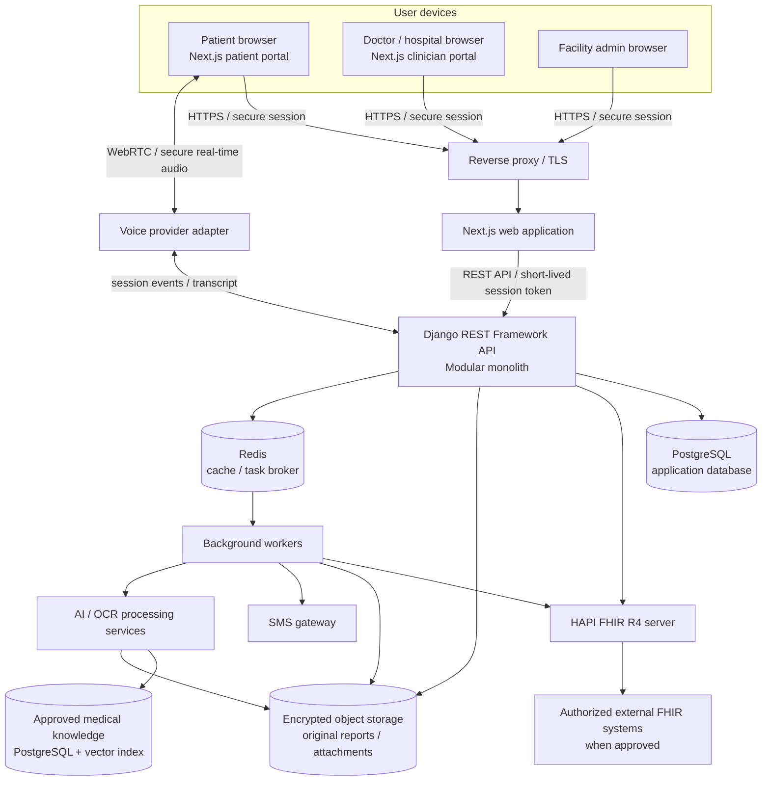
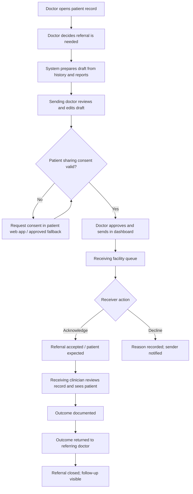

# Medi Waypoint — System Architecture

**Document type:** Technical architecture and implementation blueprint  
**Project:** Medi Waypoint: From First Symptom to Referral Outcome  
**Architecture status:** Proposed target architecture for the first working release  
**Primary platform:** Web application (patient portal + clinician portal)  
**Standards direction:** HL7 FHIR R4 and applicable Bangladesh Core profiles

---

## 1. Executive summary

Medi Waypoint is a patient-navigation, clinical-record and closed-loop referral platform for Bangladesh. It connects the patient's first interaction with the healthcare system to a suitable doctor, carries relevant medical information between providers, and returns the referral outcome to the referring provider.

The platform has two connected capabilities:

1. **Patient navigation:** A patient visits the Medi Waypoint website and starts a Bangla- or English-language voice triage session in the browser. The agent asks structured follow-up questions, applies clinician-authored emergency rules, provides only limited guidance supported by approved medical sources, and helps the patient request an appointment with an appropriate doctor.
2. **Clinical records and referrals:** Doctors and authorized hospital staff use the clinician dashboard to manage appointments, patient records, investigation reports and referrals. AI may extract report values or draft summaries, but clinicians verify and approve clinical actions through the dashboard.

Both capabilities use one patient record and one referral workflow. The platform is designed to work with public and private facilities, support low-connectivity emergency workflows, and exchange standardized data through an open FHIR API.

### 1.1 Decisions already established

| Topic | Architecture decision |
|---|---|
| Patient entry point | Patient visits the Medi Waypoint website; no telephone call is required for the primary triage flow. |
| Voice interaction | Browser microphone and real-time voice session, with Bangla and English support. |
| Doctor approvals | Appointment and referral decisions are performed in the authenticated doctor dashboard. |
| SMS | Optional OTP, booking notifications, reminders and status notifications only. SMS is not the doctor's approval interface. |
| AI authority | AI assists with triage within defined limits, report extraction and draft summaries. It does not diagnose, prescribe, approve or send a referral independently. |
| Clinical authority | A licensed clinician retains responsibility for clinical decisions and approves referrals before sending. |
| Interoperability | HL7 FHIR R4, aligned with the applicable Bangladesh Core profiles and national integration requirements. |
| Hosting direction | Bangladesh-based hosting for application and patient data, subject to the approved deployment and service arrangements. |

### 1.2 Recommended engineering approach

Start with a **modular monolith**, not a collection of microservices. Keep the application domains separated in Django, deploy background workers independently, and run HAPI FHIR as a separate interoperability service. This gives the team clear boundaries without the operational overhead of distributed services before the product and workflows are proven.

---

## 2. Product boundaries and user applications

### 2.1 Patient web application

The patient-facing portal is responsive and designed primarily for mobile browsers. It should provide:

- Public project information and clear emergency disclaimers.
- Patient registration, sign-in and identity verification where required.
- A **Talk to the AI Triage Assistant** entry point.
- A visible Bangla / English language choice and language switching during a session.
- Microphone permission explanation and audio-device checks before the session begins.
- A live voice interface with listening, speaking, connection and error states.
- A text-based fallback when microphone access or real-time audio is unavailable.
- A reviewable triage summary in the patient's own words, including the questions asked and guidance provided.
- Doctor discovery by area, specialty, facility and current availability.
- Appointment request status and confirmed appointment details.
- Patient-accessible reports and records, subject to identity and access controls.
- Consent screens explaining exactly which information will be shared and with whom.

**Important limitation:** Browser-based voice requires a supported browser, network connectivity and microphone permission. It does not provide the same access as a telephone hotline on a basic feature phone. A future assisted-access workflow may let a community health worker use the web application on behalf of a patient, but that is not a substitute for the browser-based MVP.

### 2.2 Clinician web application

Doctors and authorized facility users use the same Next.js application through protected clinician routes. Role and facility permissions determine what each user can see and do.

Core dashboard areas:

- Overview and pending work queue.
- Appointment requests, schedules and availability management.
- Patient search and authorized patient charts.
- Triage summaries awaiting review.
- Encounters, observations, allergies, medication history and reports.
- Incoming referrals requiring acknowledgement.
- Outgoing referrals and draft summaries awaiting the sending doctor's approval.
- Referral status and outcome reporting.
- Facility services and dated capacity information.
- Notifications and audit history appropriate to the user's role.

The doctor approves or rejects appointment requests and reviews/approves outgoing referral packages **inside this dashboard**. The receiving facility also acknowledges or declines an incoming referral in its dashboard. SMS may notify a doctor that an item is waiting, but the actionable decision remains in the web application.

### 2.3 Facility administration

A facility administrator or authorized coordinator maintains:

- Facility identity, location and contact information.
- Departments, specialties and available services.
- Practitioner-to-facility relationships.
- Appointment slots and service availability.
- Dated capacity reports, with the date and source visible.
- Staff accounts and role assignments.

Do not present a manually updated capacity report as live bed availability. Display its last-updated time and mark stale information clearly.

---

## 3. High-level system architecture



### 3.1 Main components

| Component | Responsibility | Suggested implementation |
|---|---|---|
| Patient and clinician UI | Role-specific web workflows and responsive dashboards | Next.js + TypeScript |
| Reverse proxy | TLS termination, routing, request limits and security headers | Nginx or equivalent |
| Application API | Authentication, authorization, domain logic, validation and workflow orchestration | Django + Django REST Framework |
| Realtime application layer | Realtime session events and any application-owned WebSocket endpoints | Django ASGI deployment |
| Application database | Accounts, facility directory, schedules, workflow indexes, configuration and operational state | PostgreSQL |
| FHIR server | Persist, validate, version and expose standardized FHIR resources | HAPI FHIR R4 |
| Background processing | OCR, AI summaries, notifications, FHIR synchronization and scheduled jobs | Celery workers + Redis (or an equivalent queue) |
| Object storage | Original PDF/photo reports and other protected attachments | Private S3-compatible object storage, e.g. MinIO |
| Knowledge retrieval | Search approved medical passages for grounded answers | PostgreSQL with pgvector or another approved vector index |
| Voice adapter | Abstract the browser voice provider and prevent provider lock-in | Internal Django integration module + provider SDK/API |
| SMS adapter | OTP and notification delivery | Pluggable SMS gateway integration |
| Observability | Application logs, metrics, traces, alerts and audit review | Structured logging + metrics/monitoring stack |

### 3.2 Application structure

Use one Django codebase with domain-oriented apps. Deploy the API and background workers as separate processes from the same codebase.

Suggested Django modules:

```text
backend/
  config/                 # settings, URLs, ASGI, WSGI
  apps/
    accounts/             # authentication, users, roles, sessions
    identity/             # patient identity, identifiers, duplicate candidates
    organizations/        # facilities, departments, practitioners
    directory/            # services, specialties, locations, capacity reports
    scheduling/           # schedules, slots, appointment requests
    triage/               # triage sessions, transcripts, structured summaries
    records/              # encounters and clinical record orchestration
    documents/            # uploads, OCR jobs, extracted-value review
    referrals/            # referral lifecycle and handover workflow
    consent/              # consent capture, scope and revocation
    notifications/        # email/SMS/in-app notification adapters
    fhir/                 # profiles, mappings, validation, HAPI client
    ai/                   # RAG, model adapters, prompt and output validation
    audit/                # access/change events and audit reporting
    integrations/         # national/external integration adapters
  workers/                # task definitions and schedules
```

Keep the domain modules independent at the code level. Do not split them into separate network services until scale, ownership or deployment constraints justify it.

---

## 4. Data ownership and persistence strategy

The project needs PostgreSQL and HAPI FHIR, but they must not become competing sources of truth.

### 4.1 Recommended ownership model

| Data domain | Authoritative store | Notes |
|---|---|---|
| User accounts, credentials, roles and sessions | Django / PostgreSQL | Authentication and application authorization remain in the application. |
| Facility directory, practitioners' platform accounts, specialties and internal configuration | Django / PostgreSQL | Publish interoperable Organization, Practitioner and HealthcareService representations to FHIR where required. |
| Slot inventory and operational scheduling rules | Django / PostgreSQL | Represent relevant schedules, slots and confirmed appointments in FHIR. Define one controlled synchronization path. |
| Clinical record and exchange resources | HAPI FHIR | FHIR resources are the canonical interoperable representation. Local database rows may index or cache resource IDs/version IDs, but must not silently diverge. |
| Referral workflow orchestration | Django / PostgreSQL, projected to FHIR | Store internal transition locks, queue state and idempotency keys; publish the clinical referral as ServiceRequest and the actionable workflow as Task where appropriate. |
| Original report files | Private object storage | Store immutable originals. Link through DocumentReference and controlled attachment references. |
| OCR output and AI drafts | Django / PostgreSQL as unverified drafts | Do not create verified clinical Observations or final referral statements until a clinician reviews and accepts the extracted content. |
| Audit events | Append-only application audit pipeline, represented in FHIR where appropriate | Do not rely solely on editable application logs. Restrict access and retention. |
| Approved medical sources and embeddings | Controlled knowledge repository | Store source identity, version, rights, publication date and passage provenance. |

### 4.2 Synchronization rules

- The browser must never write directly to PostgreSQL or HAPI FHIR.
- All writes pass through Django authorization and domain validation.
- The FHIR module maps validated domain actions into FHIR R4 resources and sends them through the HAPI FHIR API.
- Use FHIR transaction Bundles for related resource changes that need to succeed together where supported by the selected HAPI configuration.
- Use an **outbox pattern** for events that must be delivered after a database transaction, such as notifications and retryable external synchronization.
- Every asynchronous command must have an idempotency key. A retry must not create a duplicate appointment, referral or Observation.
- Keep FHIR logical IDs and version IDs in the application database as references/indexes, not as independently editable copies of the clinical record.
- Do not report an action as fully completed until the required FHIR write has succeeded. Show pending synchronization or an actionable error when it has not.

### 4.3 Proposed FHIR resource mapping

Confirm the exact Bangladesh Core profile package, canonical URLs, terminology bindings and mandatory fields with the relevant authority before implementation. The following is a starting mapping, not a claim that every resource/profile is already approved for national exchange.

| Use case | Candidate FHIR R4 resources |
|---|---|
| Patient identity | Patient |
| Doctors and facilities | Practitioner, PractitionerRole, Organization, Location, HealthcareService |
| Doctor availability | Schedule, Slot |
| Appointment | Appointment |
| Patient visit | Encounter |
| Vitals and confirmed clinical measurements | Observation |
| Diagnoses entered by clinicians | Condition |
| Allergies | AllergyIntolerance |
| Current medication history | MedicationStatement and/or the locally approved IPS mapping |
| Uploaded report metadata | DocumentReference; Binary only where appropriate and permitted |
| Extracted/verified test report | DiagnosticReport and Observation |
| Referral order | ServiceRequest |
| Referral acceptance, assignment and workflow state | Task |
| Patient authorization | Consent |
| Essential cross-provider summary | Composition following the applicable International Patient Summary (IPS) guidance |
| Access and security audit | AuditEvent |
| Origin and revision history of generated/updated data | Provenance |

---

## 5. Core workflows

### 5.1 Browser-based voice triage

The patient enters the website and chooses **Start voice triage**. No telephone number is dialled and no call-centre workflow is required for the primary product.

```mermaid
sequenceDiagram
    actor Patient
    participant Web as Patient web app
    participant API as Django API
    participant Voice as Voice provider adapter
    participant Rules as Red-flag rules
    participant RAG as Approved-source retrieval
    participant FHIR as HAPI FHIR

    Patient->>Web: Select language and start triage
    Web->>Patient: Explain limitations and request microphone permission
    Patient->>Web: Grant permission and begin speaking
    Web->>API: Create triage session
    API->>API: Verify session, consent and rate limits
    API-->>Web: Short-lived voice session authorization
    Web->>Voice: Establish browser audio session
    Voice-->>API: Transcript / turn events (provider adapter)
    API->>Rules: Evaluate clinician-authored danger signs first
    alt Emergency danger sign detected
      Rules-->>API: Emergency pathway
      API-->>Web: Stop normal triage; show and speak emergency instruction
    else No emergency danger sign detected
      Rules-->>API: Continue bounded triage
      API->>RAG: Retrieve from approved, versioned sources if guidance requested
      RAG-->>API: Supporting passages or no adequate support
      API-->>Web: Grounded response or safe decline
    end
    API->>FHIR: Save approved session summary as appropriate
    API-->>Web: Present summary for patient review
    Patient->>Web: Confirm summary / request doctor
    Web->>API: Save patient-approved summary and next step
```

**Voice session implementation rules**

- Keep the **triage orchestrator inside Medi Waypoint's backend**. The voice vendor must not be configured as an independent medical agent that can answer the patient or make clinical decisions without the backend's checks.
- Treat the voice vendor as a replaceable speech component: browser audio transport and/or speech-to-text and text-to-speech. The backend owns the conversation state, red-flag evaluation, approved-source retrieval, response policy and saved summary.
- The safe turn sequence is: browser audio -> speech component -> backend transcript event -> deterministic safety checks -> approved-source retrieval if appropriate -> validated response text -> speech component/browser playback. Do not allow an unreviewed model response from the vendor to bypass this sequence.
- If the selected provider offers an integrated voice-agent SDK, use it only if its control flow can enforce the same backend-owned safety policy, source restrictions and logging. Otherwise use separate speech-to-text/text-to-speech components.
- Use the browser microphone via `getUserMedia` after a clear user action and permission prompt.
- Prefer a supported secure real-time audio transport such as WebRTC where the selected provider supports it. Use WebSocket only where the provider's supported architecture requires it.
- Keep provider master API keys on the server. The backend issues short-lived, narrowly scoped session credentials where supported.
- Put all voice vendors behind a provider adapter so the team can change from a hosted service to an approved/open-source speech stack without rewriting triage logic.
- The voice provider is a speech transport/processing component, not the owner of clinical logic or patient records.
- Minimize identifying information sent to the voice vendor. Use a random session identifier; do not send the patient's name, phone number or medical-record identifier unless an approved service arrangement explicitly requires it.
- Disable audio retention by default where the provider permits it. Document any unavoidable processing location, retention and subprocessors before pilot approval.
- Persist only the minimum transcript/summary required by the approved retention policy. Make the patient aware of recording/transcription behavior before starting.
- Provide a visible stop/end control, reconnect behavior, timeout handling and an accessible text fallback.

### 5.2 Clinical safety sequence for triage

The model must not decide whether a patient is safe. The sequence is deliberately constrained:

1. Speech is transcribed and normalized, preserving the patient's original wording where possible.
2. Clinician-authored deterministic red-flag rules run before any generative guidance.
3. If a danger sign is detected, stop the ordinary flow and immediately show/speak the emergency instruction approved by clinicians. The product must not keep the user answering nonessential questions.
4. If no danger sign is detected, use retrieval only over a versioned, clinician-approved knowledge base.
5. Generate an answer only when retrieved evidence supports it. Otherwise decline and offer a clinician.
6. Do not diagnose, prescribe, give medicine doses or independently choose a treatment.
7. Record the rule-set version, knowledge-source version, supporting passage IDs, model version and response for review.
8. Test both Bangla and English, including colloquial speech, code-switching, negation, numbers, age, symptom duration and speech-recognition errors.

The triage screen must state clearly that the agent is an automated guide and not a doctor. Emergency instructions and local emergency numbers must be clinically and operationally verified before pilot deployment.

### 5.3 Appointment request and doctor-dashboard approval

The patient selects a doctor and an available slot, then submits an appointment request. The request appears in the doctor's dashboard. The doctor reviews the request and triage summary and accepts, proposes another slot or declines it from the dashboard.

Suggested appointment states:

```text
AVAILABLE
  -> REQUESTED
  -> CONFIRMED (doctor accepts in dashboard)
  -> COMPLETED
  -> CANCELLED / NO_SHOW

REQUESTED -> ALTERNATE_SLOT_PROPOSED -> PATIENT_ACCEPTED -> CONFIRMED
REQUESTED -> DECLINED
REQUESTED -> EXPIRED
```

Rules:

- A request is not labelled confirmed until the doctor or an authorized scheduling user accepts it in the dashboard.
- Prevent double booking with a database transaction and uniqueness/locking strategy for the relevant practitioner, facility and slot.
- Define a clear request expiry policy and show it to the patient.
- Send SMS/in-app notifications after a dashboard action; notifications do not perform the action.
- Maintain an auditable record of who accepted, declined, rescheduled or cancelled the appointment and when.

### 5.4 Patient record and report processing

1. Authorized staff open or create the patient record.
2. A visit is recorded as an Encounter with relevant observations and documents.
3. The original PDF or photograph is uploaded to private object storage and remains unchanged.
4. A background task runs OCR and extracts candidate test name, result, unit, date and laboratory/facility when available.
5. The UI displays extracted values beside the original report, with uncertainty or missing fields clearly marked.
6. A clinician corrects and confirms values. Only confirmed clinical results are represented as verified clinical resources.
7. Earlier results are shown with date and laboratory so the clinician can decide whether a test needs repeating. The application must never cancel or suppress a test automatically.

Use secure, short-lived download links or backend-mediated access checks. Do not expose object-storage buckets publicly.

### 5.5 Referral creation, approval, handover and outcome



Recommended lifecycle:

```text
DRAFT
 -> AWAITING_PATIENT_CONSENT
 -> READY_FOR_SENDER_APPROVAL
 -> APPROVED_BY_SENDER
 -> SENT
 -> ACKNOWLEDGED_BY_RECEIVER
 -> IN_PROGRESS
 -> OUTCOME_RECORDED
 -> OUTCOME_RETURNED
 -> CLOSED
```

Possible alternative or exception states include `DECLINED`, `CANCELLED`, `EXPIRED`, `ESCALATED` and `FAILED_TO_SYNC`. Each transition must be permission-checked and audited.

Key rules:

- AI creates a draft only. The sending clinician reviews, edits and approves it in the clinician dashboard.
- Patient consent is a distinct action from doctor approval. Capture it in the patient web app with the recipient, information scope and purpose clearly shown. SMS OTP can verify a phone or notify the patient, but an SMS reply is not a substitute for the dashboard's doctor approval.
- The receiving doctor/facility acknowledges or declines the referral in its dashboard. A sender-side “sent” status is not proof that the receiver accepted it.
- The sender must see the referral's current state and any rejection/decline reason.
- A referral is not considered closed until an outcome has been recorded and returned, or a documented exception closure has been made.
- Escalate unanswered emergency referrals after a clinician/facility-approved time threshold. The threshold must be configured and tested with pilot facilities, not guessed in code.

### 5.6 Emergency referral and low-connectivity operation

Emergency transfer must not be blocked by comprehensive data entry. Use the five-field minimum dataset described in the proposal:

1. Patient identity (or an explicit unknown/unverified identity state).
2. Reason for transfer.
3. Urgency.
4. Vital signs.
5. Treatment already given.

When connectivity is unavailable:

- The emergency form can be queued locally on an authorized facility device.
- Queue entries carry a unique idempotency key, creation time, facility identity and sync status.
- The patient/family can leave with a printed referral slip containing the minimum necessary details and a reference code.
- On reconnection, the client synchronizes queued items and displays success or conflict/error states to staff.
- Do not store a full patient chart offline. Keep offline data to the minimum needed for the transfer, encrypt local storage where technically feasible, restrict device access and clear local copies after confirmed synchronization.
- If the patient is in immediate danger, the workflow must prioritize transfer and direct communication over software completion.

The browser voice triage experience itself requires connectivity. When it is unavailable, the application should clearly offer the approved emergency/contact instructions and a non-voice fallback; it must not imply that a live AI session can continue offline.

---

## 6. AI and document-intelligence architecture

### 6.1 AI services

Keep the following functions separate, versioned and independently testable:

| AI function | Input | Output | Human control |
|---|---|---|---|
| Voice triage response | Patient utterance, deterministic safety state, approved passages | Bounded response or decline | Clinician-authored rules and source review; no diagnosis or prescription |
| Medical report extraction | Original report image/PDF | Candidate values, units, dates and source locations | Clinician verifies/corrects before values enter the verified record |
| Referral summary drafting | Existing patient record and selected reports | Draft narrative with source references | Sending doctor edits and approves before sending |

### 6.2 Knowledge retrieval (RAG)

- Ingest only open, licensed or explicitly permissioned sources.
- Store source title, publisher, rights/permission status, version, publication date, effective date and language.
- Split documents into traceable passages; preserve page/section metadata.
- Clinicians approve and version the active knowledge collection.
- Retrieve passages with source identifiers and relevant metadata.
- Return an answer only when evidence meets the clinically approved support threshold; otherwise decline.
- Log the retrieved passage IDs and knowledge-base version with each answer.
- Prevent uploaded patient documents from being treated as trusted medical guidance. Patient uploads are clinical data, not knowledge-base instructions.

### 6.3 Structured AI output

All generated outputs should conform to validated schemas. For example, a referral draft should include:

- Patient and encounter references.
- Reason for referral.
- Current symptoms and relevant history.
- Allergies and current medicines where available.
- Relevant investigations with dates, units and source report references.
- Treatment already given.
- Urgency selected/confirmed by the clinician.
- Missing or uncertain information.
- Source references for each extracted/generated statement.

The model must not invent missing values. Unknown fields remain explicitly unknown or absent.

### 6.4 Model hosting and privacy

The proposal's direction is to run the language model and medical logic on infrastructure hosted in Bangladesh. Keep model inference behind an internal AI service interface. Before a pilot, verify the hosting location, model license, operational capacity, data retention, provider subprocessors and whether any voice provider processes audio outside Bangladesh. A Ministry-approved hosted speech provider or a suitable self-hosted/open-source speech alternative may be selected after a proof of concept and compliance review.

---

## 7. Security, consent and privacy architecture

Health information is sensitive. Security must be implemented as a core system capability, not added at the end.

### 7.1 Authentication and authorization

- Separate patient, clinician, facility-staff and platform-administrator roles.
- Use server-managed sessions or secure short-lived tokens in `HttpOnly`, `Secure`, appropriately configured `SameSite` cookies. Do not store long-lived authentication tokens in browser local storage.
- Apply CSRF protections where cookie-based authentication is used.
- Require strong authentication for clinicians and administrators; consider MFA for these roles.
- Use role-based permission checks plus patient/facility/relationship checks. A clinician's role alone must not grant access to every patient in the platform.
- Enforce authorization at the API/service layer for every patient, report, referral, export and download request.
- Use short-lived, scoped access to attachments.
- Add rate limits and abuse protection to login, OTP, triage-session creation and public endpoints.

### 7.2 Consent

Represent consent as a specific, reviewable authorization rather than a single generic “agree” flag.

Capture:

- Patient identity/verification context.
- Recipient doctor/facility.
- Purpose of sharing.
- Categories of data to be shared.
- Consent timestamp, method and policy version.
- Expiry or scope limits where applicable.
- Withdrawal/revocation status and timestamp.

The UI must distinguish consent to use the triage feature from consent to share a medical record with a named provider. Follow applicable law and Ministry policy for emergency access and consent exceptions.

### 7.3 Emergency break-glass access

If a patient cannot provide consent during a genuine emergency, an authorized clinician may use a controlled emergency-access workflow only if approved by policy. Require a reason, record the user and time, restrict the scope where possible, generate an audit event and flag the access for retrospective review. Do not implement unrestricted “admin can see everything” access as a replacement.

### 7.4 Audit and provenance

Audit events should capture at least:

- User/service identity and facility context.
- Patient/resource accessed.
- Action performed (read, create, update, export, share, download, break-glass).
- Timestamp, outcome and reason where relevant.
- Source IP/device/session metadata as appropriate and lawful.

Use FHIR `AuditEvent` for relevant standardized security/audit exchange and `Provenance` for the origin and revision of clinical data or generated content. Protect audit logs against ordinary user edits and define retention/review policy.

### 7.5 Data protection controls

- TLS for all network communication.
- Encryption at rest for database backups, object storage and disks.
- Private network access for PostgreSQL, Redis, HAPI FHIR and object storage.
- Managed secrets; no credentials in source control or frontend bundles.
- Database backups with tested restore procedures.
- Security updates, dependency scanning and vulnerability management.
- PII/PHI redaction in operational logs and error reports.
- Data retention and deletion policy approved before pilot.
- No patient data in analytics or model-training workflows without explicit opt-in, ethics approval and approved de-identification controls.

---

## 8. API and integration boundaries

Expose a documented application API through Django. Use REST for normal request/response operations. Use WebSocket only for application events that require it; real-time voice transport is handled by the selected provider's supported browser transport.

Suggested API groups (illustrative, not final endpoint contracts):

```text
/api/v1/auth/*
/api/v1/patients/*
/api/v1/practitioners/*
/api/v1/facilities/*
/api/v1/directory/*
/api/v1/appointments/*
/api/v1/triage/sessions/*
/api/v1/records/*
/api/v1/documents/*
/api/v1/referrals/*
/api/v1/consents/*
/api/v1/notifications/*
/api/v1/admin/*
/api/v1/integrations/fhir/*
```

### Integration rules

- The Next.js application calls Django; it does not call the database or HAPI FHIR directly.
- External FHIR systems connect through the controlled FHIR integration boundary.
- The platform's FHIR API must publish a `CapabilityStatement` and document supported resources, profiles, operations, search parameters and authorization requirements.
- Validate incoming/outgoing resources against the selected FHIR R4 and Bangladesh Core profiles.
- Use terminology bindings and code systems agreed with the relevant health authority; do not hard-code unverified local codes.
- Use stable identifiers and idempotent integration operations.
- Keep the national Health ID and Shareable Health Record integration behind an adapter so it can be enabled only after access and technical specifications are approved.

---

## 9. Deployment architecture

### 9.1 Initial pilot deployment

A container-based deployment in a Bangladesh-based data center is sufficient for the first pilot. Kubernetes is not required for the initial version unless the hosting environment or operational team already requires it.

Suggested deployment units:

```text
Public network
  └── Reverse proxy / WAF / TLS
       ├── Next.js web container
       └── Django ASGI API container

Private application network
  ├── Django background worker container(s)
  ├── Scheduler container
  ├── PostgreSQL (application database)
  ├── HAPI FHIR R4 server + its persistence database
  ├── Redis
  ├── Private object storage
  └── AI/OCR inference services

External approved integrations
  ├── Browser voice provider / speech infrastructure
  ├── SMS gateway
  └── Authorized national FHIR endpoints (future / approval-dependent)
```

Only the reverse proxy should be publicly reachable. HAPI FHIR, PostgreSQL, Redis, object storage and workers should remain private. Use separate database credentials and least-privilege network rules.

### 9.2 Environments and delivery pipeline

Maintain separate `local`, `staging` and `production/pilot` environments. Use environment-based configuration and secrets management. The CI pipeline should run:

1. Formatting, linting and static checks.
2. Backend unit tests and frontend checks.
3. Database migration checks.
4. API and FHIR profile validation tests.
5. Frontend production build.
6. Container security/dependency checks.
7. Integration/E2E tests in staging before deployment.

Use versioned database migrations. Deploy application and HAPI/FHIR changes in a controlled order with a rollback plan. Test backup restoration rather than treating successful backup creation as sufficient.

### 9.3 Observability and operations

Track:

- API latency, error rate and request volume.
- Voice-session connection failures, turn latency and session completion rate.
- AI refusal rate, unsupported-answer rate and clinician-reviewed error rate.
- OCR extraction correction rate.
- FHIR validation failures and synchronization backlog.
- Appointment request age and decision time.
- Referral acknowledgement time, overdue emergency referrals and outcome-return rate.
- Queue depth, task retries and failed jobs.
- Storage, database health and backup status.

Operational dashboards must not expose patient-level sensitive information to users who do not need it.

---

## 10. Non-functional requirements

| Area | Initial requirement |
|---|---|
| Safety | Emergency rules precede generative guidance; no diagnosis/prescription; clinician approval for referrals. |
| Privacy | Patient consent, least-privilege access, audit logging, data minimization and approved hosting. |
| Reliability | Idempotent writes, retryable background jobs, backups, restore testing and visible sync failures. |
| Interoperability | FHIR R4 validation and applicable Bangladesh Core conformance for supported resources. |
| Accessibility | Mobile-responsive UI, readable Bangla/English text, keyboard access and clear voice/text controls. |
| Low connectivity | Minimal emergency referral queue, printable slip and explicit sync status. |
| Performance | Define targets after pilot load assumptions; avoid unsubstantiated response-time promises. |
| Scalability | Begin as a modular monolith; separate worker/API capacity and optimize only from measured load. |
| Maintainability | API contracts, domain boundaries, schema validation, automated tests and documented deployment. |
| Auditability | Trace patient-data access, doctor approvals, referral state changes and AI-generated drafts. |

---

## 11. Key risks and architectural controls

| Risk | Control |
|---|---|
| Browser microphone unavailable or denied | Preflight check, clear permission explanation and text-based fallback. |
| Poor Bangla speech recognition | Clinician-reviewed test corpus, user confirmation of summary, safe retry and text correction. |
| Dangerous symptom missed by model | Deterministic clinician-authored red-flag rules before generative responses; scripted evaluation and clinician sign-off. |
| AI produces unsupported medical guidance | Approved-source retrieval, evidence logging, refusal when unsupported and versioned source list. |
| OCR extracts incorrect values | Preserve original report; mark output unverified; clinician correction before clinical use. |
| Doctor does not review pending requests | Dashboard queue, notification reminders, age indicators and facility-approved escalation. |
| Referral receiver does not acknowledge | Explicit receiver state, escalation for emergency referrals and sender visibility. |
| Duplicate patient identities | Suggest possible duplicates; require authorized human resolution; never merge automatically. |
| FHIR and application state diverge | Clear data ownership, validation, idempotency, outbox/retry and visible sync state. |
| Connectivity fails during emergency transfer | Minimum-data offline queue, printed slip and no software-imposed transfer delay. |
| Third-party voice service processes data outside Bangladesh | Data minimization, no identity in voice stream, vendor/privacy review and approved/self-hosted alternative. |
| Facility availability information is stale | Timestamp all capacity data; display freshness and source; avoid representing stale data as live. |

---

## 12. Decisions to validate before implementation/pilot

The proposal does not provide enough operational detail to treat the following as settled. Confirm them with clinicians, facilities and the appropriate authority:

1. The exact Bangladesh Core Implementation Guide/package version, profile canonical URLs and required terminology.
2. The approved patient identity matching and Health ID integration approach.
3. Whether the pilot requires patient accounts before voice triage, or supports a limited guest triage session followed by identity linking.
4. The appointment policy: request-and-approve, instant booking for selected doctors, or a configurable combination. This blueprint assumes request-and-approve because the agreed change requires doctors to decide in the dashboard.
5. The voice provider, hosting/processing location, language performance, retention behavior and Ministry approval.
6. Emergency danger-sign rules, escalation thresholds and approved emergency instructions.
7. Consent language, emergency exceptions, retention and revocation policy.
8. Facility capacity data ownership and update frequency.
9. The offline device model, local storage protection and printed-slip format.
10. National Health ID / Shareable Health Record access and technical integration requirements.

---

## 13. Recommended implementation order

Build the reliable patient-record and referral foundation before investing heavily in advanced voice features:

1. Identity, accounts, roles and facility directory.
2. Doctor dashboard and appointment request/approval workflow.
3. Patient record, encounters, documents and FHIR foundation.
4. Referral lifecycle, sender approval, receiver acknowledgement and outcome return.
5. OCR and AI referral-summary drafting with clinician verification.
6. Browser-based voice triage with red-flag rules and approved-source retrieval.
7. Emergency offline queue, audit/security hardening and pilot readiness.

This order ensures that Medi Waypoint's core value—continuity of care and accountable referrals—works even if the AI or voice provider is unavailable.

---

## 14. Reference material

- **Project source:** *Medi Waypoint: From First Symptom to Referral Outcome* (11-page proposal supplied by the project team).
- HL7 FHIR R4 specification: https://hl7.org/fhir/R4/
- HL7 FHIR R4 security and privacy: https://hl7.org/fhir/R4/secpriv-module.html
- HL7 FHIR R4 Provenance: https://hl7.org/fhir/R4/provenance.html
- HAPI FHIR documentation: https://hapifhir.io/hapi-fhir/docs/
- Next.js deployment documentation: https://nextjs.org/docs/app/getting-started/deploying
- Next.js production checklist: https://nextjs.org/docs/app/guides/production-checklist

