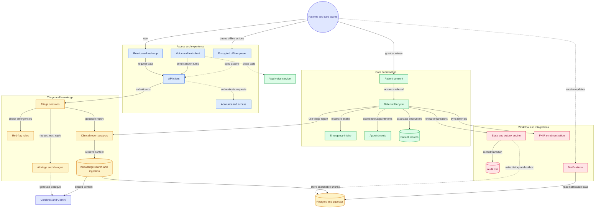

# Medi Waypoint

**A Bangla/English voice and written triage agent with a closed-loop referral service that carries one patient thread from first symptom to outcome.**

Medi Waypoint supports patients, Community Health Workers (CHWs), clinicians and receiving hospitals across Bangladesh. It is designed for patients with limited digital access, literacy, connectivity or personal devices.

> Medi Waypoint is decision support, not a diagnostic tool. The AI never diagnoses or prescribes (INV-7), and deterministic red-flag rules run before any model output (INV-8). An emergency is never blocked (INV-16).

---

## What it does

### AI triage (voice and text)
- **Phone-call-style voice triage** through [Vapi](https://vapi.ai): ringing → connected → listening → speaking, with a mobile-first, Siri-style glowing blob and live Bangla/English captions. Text mode is always available as a fallback.
- **LLM triage orchestrator on the backend** (Cerebras `qwen-3.8-27b`) with a daily spend guard. Deterministic red-flag rules run first and escalate emergencies immediately.
- **Post-consultation report generator** that turns a triage session into a structured summary for the clinician.
- **RAG knowledge base** on Postgres + pgvector (Gemini `gemini-embedding-001`, 1,024 dimensions, multi-key fallback). Platform admins upload and approve reference books from the Knowledge base page; ingestion is resumable.

### Referrals
- **Closed-loop workflow:** `DRAFT → CONSENT_REQUESTED → READY_FOR_SENDER_APPROVAL → SENT → ACKNOWLEDGED_BY_RECEIVER → IN_PROGRESS → OUTCOME_RETURNED → CLOSED`, with escalation and reminder timers (Celery beat) and an outbox for reliable delivery.
- **Patients without a phone:** CHWs register patients with no phone, email or NID. Each patient gets a system ID (`MWP-XXXXXXXX`) searchable across authorised facilities.
- **Assisted in-person consent** (verbal or paper, with a witness). It only advances a referral to `READY_FOR_SENDER_APPROVAL`; clinician approval is never bypassed.
- **Printable referral slip with a zero-PII QR** that encodes only the opaque token `MW-REF:<code>`.
- **Receiving-facility partial intake** when the sender is offline, with deterministic reconciliation when the full referral syncs (no duplicates, no status regression).

### Continuity during network failure
- **Encrypted offline queue** (`frontend/src/offline/`): IndexedDB with non-extractable Web Crypto AES-GCM 256, ordered per-referral actions, single-flight sync, backoff and strict multi-user isolation on shared devices.

### Access control
- Role-based access (patient, CHW, clinician, facility staff, platform admin) with a consent-scoped care relationship. Out-of-scope records return `404` (INV-9). Demo accounts are created by `backend/seed_demo_data.py`.

---

## Architecture



---

## Stack

| Layer | Technology |
|---|---|
| Frontend | Next.js 15 (App Router), React 19, TypeScript, Tailwind v4 design tokens, TanStack Query, Vitest, Playwright |
| Backend | Django 6, DRF, Channels (ASGI, WebSocket `/ws/events`), Celery + beat, session cookies + CSRF |
| Data | PostgreSQL 16 with pgvector, Redis, MinIO (object storage) |
| AI | Cerebras (chat), Gemini (embeddings), Vapi (voice) |
| i18n | English and Bangla, lazy-loaded namespaces |

Backend apps live in `backend/apps/` (`accounts`, `referrals`, `triage`, `knowledge`, `ai`, `workflow`, `consent`, `fhir`, `notifications` and others).

---

## Local development

Prerequisites: Python 3.11+, [uv](https://docs.astral.sh/uv/), Node.js 20+, and PostgreSQL with the `pgvector` extension (or use Docker Compose below).

```bash
cp .env.example .env        # then fill in the values you need
```

**Backend**
```bash
cd backend
uv sync                     # installs dependencies from uv.lock
uv run python manage.py migrate
uv run python seed_demo_data.py   # optional demo accounts
uv run python manage.py runserver 127.0.0.1:8000
```

**Frontend**
```bash
cd frontend
npm ci
npm run dev                 # http://localhost:3000, /api is proxied to the backend
```

**Everything with Docker** (edge nginx, web, api, Celery workers and beat, Postgres, Redis, MinIO):
```bash
docker compose up --build
```

### Configuration

All settings are environment variables; see [`.env.example`](.env.example) for the full list. Never commit real keys.

| Area | Variables |
|---|---|
| Django | `DJANGO_SETTINGS_MODULE`, `DJANGO_SECRET_KEY`, `DATABASE_URL`, `REDIS_URL`, `ALLOWED_HOSTS`, `CSRF_TRUSTED_ORIGINS` |
| Voice (Vapi) | `VOICE_PROVIDER`, `VAPI_PUBLIC_KEY`, `VAPI_PRIVATE_KEY`, `VAPI_ASSISTANT_ID`, `VAPI_WEBHOOK_SECRET` |
| LLM | `LLM_DAILY_BUDGET_USD`, `LLM_PRICE_IN_PER_M`, `LLM_PRICE_OUT_PER_M` |
| Embeddings / RAG | `GEMINI_API_KEY`, `GEMINI_API_KEYS` (comma-separated fallback list), `EMBEDDING_MODEL`, `KNOWLEDGE_MIN_SIMILARITY`, `KNOWLEDGE_MAX_UPLOAD_MB` |

Vapi needs a public URL for its webhook (`POST /api/v1/triage/provider-events`, header `x-vapi-secret`). Use a tunnel during local development.

### Tests and checks
```bash
# Backend
cd backend && uv run --extra dev pytest -q

# Frontend
cd frontend
npm test
npx tsc --noEmit
npm run lint:tokens
npm run tokens:check
npm run budgets:check       # first-load JS budget for patient routes
```

---

## Deployment

- **Docker Compose / VM:** see [`docs/DEPLOYMENT.md`](docs/DEPLOYMENT.md).
- **Vercel:** [`vercel.json`](vercel.json) defines two services, `backend` (Django, public on `/api/*`) and `frontend` (Next.js, everything else). Vercel has no long-running processes, so Celery workers/beat, the WebSocket and persistent media need to be hosted elsewhere, and you need an external Postgres with pgvector and Redis.

---

## Documentation

- [`MASTERPLAN.md`](MASTERPLAN.md): canonical roles, state machines, API contract, decisions and open questions.
- [`docs/BACKEND.md`](docs/BACKEND.md), [`docs/FRONTEND.md`](docs/FRONTEND.md), [`docs/UIUX_DESIGN.md`](docs/UIUX_DESIGN.md), [`docs/SECURITY.md`](docs/SECURITY.md), [`docs/DEPLOYMENT.md`](docs/DEPLOYMENT.md).
- [`Medi_Waypoint_Project_Plan.md`](Medi_Waypoint_Project_Plan.md) and [`Medi_Waypoint_System_Architecture.md`](Medi_Waypoint_System_Architecture.md).

## License

See [`LICENSE`](LICENSE).
